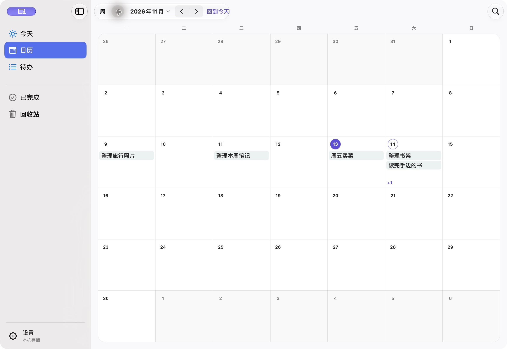

  
  <h1>Let’s Do</h1>
  
先记下来，再安排到某一天。

  

    <a href="https://github.com/JS-banana/lets-do/releases/latest"><strong>下载 Mac 预览版</strong></a> ·
    <a href="docs/USAGE.md">使用指南</a> ·
    <a href="https://github.com/JS-banana/lets-do/issues">反馈问题</a>
  

  
macOS 14 及以上 · Apple 芯片与 Intel · 免费开源

Let’s Do 是一款原生 Mac 任务应用。用它记下临时想到的事，在周历和月历里安排时间，再从「今天」看看眼下要做什么。它也能与 Apple 自带的「提醒事项」联动，让 iPhone 成为随手记录和勾选完成的入口，无需另外注册账号。

v0.3.1 界面 · 使用示例任务拍摄

<!-- 展示素材使用 v0.3.1 的应用源码、隔离的 Local 构建与示例任务；更新界面时一并更新截图和动图。 -->

## 从记录到安排

想读的书、周末要买的东西，或者刚想到的一个点子，都可以先记下来。只写一个标题也没关系，备注和日期等想清楚了再补。

准备开始做的时候，把它安排到某一天；还没确定哪天，就先放进这一周。周历适合看接下来几天，月历方便把时间拉远一点。计划有变，拖动任务就能改期。

每天打开「今天」，可以看到当天的安排，也能接着处理此前没做完的事。喜欢把计划放在眼前的话，还可以添加「今天的任务」「本周计划」或「月历总览」小组件，从桌面查看安排、勾选完成，或打开应用随手记一笔。

## 手机随手记，回到 Mac 接着安排

出门时想起一件事，可以直接记进 iPhone 自带的「提醒事项」。借助 iCloud 提醒事项同步，回到 Mac 后就能在 Let’s Do 里选择导入，再慢慢安排到这一周。

反过来也一样顺手：把 Mac 上需要带出门的某条任务发送到提醒事项，在手机上勾选完成，Mac 的 Let’s Do 读取到变化后也会把它标记为完成。这样不用再装一个手机应用，就能在两台设备之间接着处理事情。首次设置和具体同步范围见[使用指南](docs/USAGE.md#与手机上的提醒事项配合)。

## 下载与安装

从 [GitHub Releases](https://github.com/JS-banana/lets-do/releases/latest) 下载 `.dmg`，打开后把 **Let’s Do.app** 拖进「应用程序」，再从那里启动。

当前是早期预览版，尚未经过 Apple 公证。首次打开若提示无法验证开发者，先尝试打开一次，再到「系统设置 → 隐私与安全性」选择「仍要打开」。可参考 [Apple 的说明](https://support.apple.com/zh-cn/102445)。

目前提供 Mac 下载版，任务库保存在本机，跨设备联动通过 Apple 提醒事项完成。独立的 iPhone 客户端仍在开发中。重要任务建议定期[导出备份](docs/USAGE.md#备份与恢复)。

## 反馈与参与

用起来有不顺手的地方，或者遇到了问题，欢迎[提一个 Issue](https://github.com/JS-banana/lets-do/issues)。描述你当时想做什么、发生了什么，附上应用和系统版本就很有帮助；截图前记得遮住私人内容。

如果想从源码运行或参与开发，可以从[开发说明](docs/DEVELOPMENT.md)开始。界面与交互的取舍记录在[产品设计](docs/PRODUCT-DESIGN.md)，维护者的构建与发版流程见[发布说明](docs/RELEASING.md)。

[MIT License](LICENSE) © JS-banana
