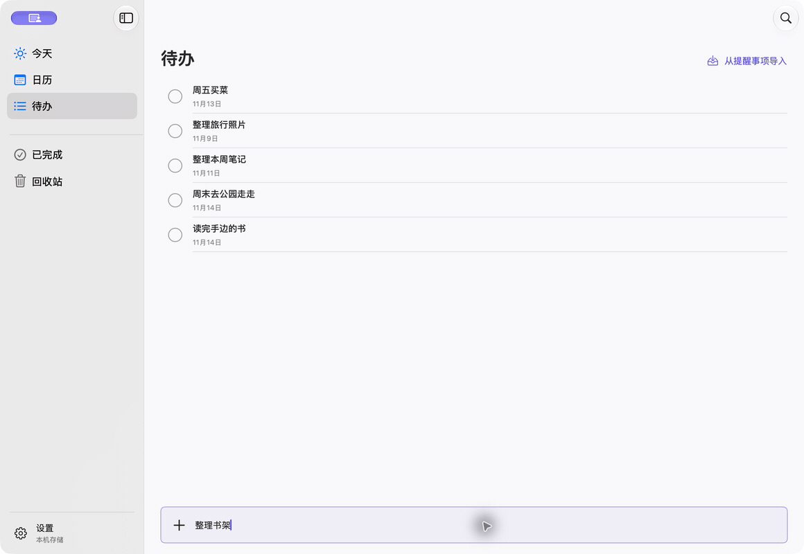

  
  <h1>Let’s Do</h1>
  
先记下来，再安排到某一天。

  

    <a href="https://github.com/JS-banana/lets-do/releases/latest"><strong>下载 Mac 预览版</strong></a> ·
    <a href="docs/USAGE.md">使用指南</a> ·
    <a href="https://github.com/JS-banana/lets-do/issues">反馈问题</a>
  

  
macOS 14 及以上 · Apple 芯片与 Intel · 免费开源

Let’s Do 是一款原生 Mac 任务应用，用日历安排待办，也能借助 Apple「提醒事项」在手机上接着处理。

v0.3.1 · 真实界面，使用示例任务演示

<!-- 动图使用与 v0.3.1 一致的应用源码、隔离的 Local 构建与示例任务，由真实操作关键帧组成；更新界面时一并更新。 -->

## 随手记，慢慢安排

想读的书、周末要买的东西，写个标题就能记下。日期还没想好，就先留在待办；准备开始时，再放进周历或月历，计划有变也能拖动改期。

每天打开「今天」，看看当天的安排，接着处理此前没做完的事。也可以把任务放到桌面小组件，随时查看、勾选完成。

## 和手机接着用

在 iPhone 自带的「提醒事项」里随手记录，借助 iCloud 同步，回到 Mac 后就能在 Let’s Do 中选择导入。

把 Mac 上的某条任务发送到提醒事项，也能带出门处理。在手机勾选完成后，Let’s Do 读取到变化时会完成对应任务。

[了解提醒事项联动](docs/USAGE.md#与手机上的提醒事项配合)

## 开始使用

[下载 Mac 预览版](https://github.com/JS-banana/lets-do/releases/latest)，打开 DMG，把 Let’s Do.app 拖进「应用程序」即可。

首次打开若被系统拦截，请参阅[安装帮助](docs/USAGE.md#安装或使用遇到问题)。

---

[反馈建议](https://github.com/JS-banana/lets-do/issues) · [参与开发](docs/DEVELOPMENT.md) · [MIT License](LICENSE)
