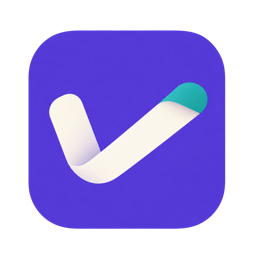

  
  <h1>Let’s Do</h1>
  
<strong>English</strong> · <a href="README.zh.md">简体中文</a>

  
Capture a task, then pick a day.

  

    <a href="https://github.com/JS-banana/lets-do/releases/latest"><strong>Download the Mac preview</strong></a> ·
    <a href="docs/USAGE.md">User guide (Chinese)</a> ·
    <a href="https://github.com/JS-banana/lets-do/issues">Report an issue</a>
  

  
macOS 14 or later · Apple silicon and Intel · Free and open source

Let’s Do is a native Mac task app. Plan your to-dos on a calendar and keep working through them on your phone with Apple Reminders.

The app in use with sample tasks

- **Capture quickly and plan by week.** While Let’s Do is running, press `⌃⌥N` in any app to jot down a task. Leave it unscheduled or assign it to a week and pick a day later.
- **Work through today’s tasks from your desktop.** Today shows what’s scheduled for today and what you haven’t finished from earlier days. Use desktop widgets to see today, this week, or the whole month and mark tasks complete.
- **Pick up on your phone.** With Reminders sync enabled, your Mac to-dos appear in Reminders on your phone. Create or complete an item in the synced list on your phone and the change syncs back to Let’s Do. [Use Apple Reminders](docs/USAGE.md#与手机上的提醒事项配合)

---

[Install and open for the first time](docs/USAGE.md#安装与首次打开) · [In-app updates](docs/USAGE.md#更新与反馈) · [Development guide (Chinese)](docs/DEVELOPMENT.md) · [MIT License](LICENSE)
