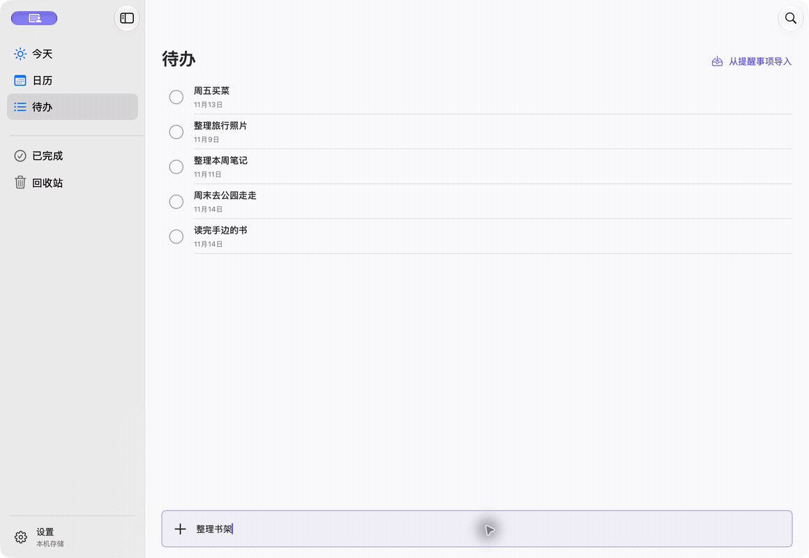

  
  <h1>Let’s Do</h1>
  
先记下来，再安排到某一天。

  

    <a href="https://github.com/JS-banana/lets-do/releases/latest"><strong>下载 Mac 预览版</strong></a> ·
    <a href="docs/USAGE.md">使用指南</a> ·
    <a href="https://github.com/JS-banana/lets-do/issues">反馈问题</a>
  

  
macOS 14 及以上 · Apple 芯片与 Intel · 免费开源

Let’s Do 是一款原生 Mac 任务应用，用日历安排待办，也能借助 Apple「提醒事项」在手机上接着处理。

真实界面，使用示例任务演示

- **随手记，按周安排。** Let’s Do 运行时，在其他应用里按 `⌃⌥N` 就能记个标题。日期还没想好就留在待办，也可以先选定一周，等有空时再安排到具体某天。
- **从桌面处理今天的事。** 「今天」列出当天安排和此前没做完的事。桌面小组件可以看今天、本周或整月的安排，直接勾选完成。
- **在手机上接着用。** 开启与提醒事项同步后，Mac 上的待办会出现在手机的提醒事项里。在手机上新建或勾选完成，也会回到 Let’s Do。[提醒事项用法](docs/USAGE.md#与手机上的提醒事项配合)

---

[安装与首次打开](docs/USAGE.md#安装与首次打开) · [应用内更新](docs/USAGE.md#更新与反馈) · [参与开发](docs/DEVELOPMENT.md) · [MIT License](LICENSE)
